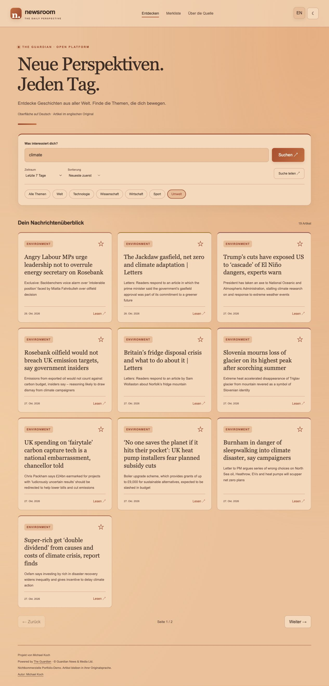

# News App · The Guardian

**Deutsch** | [English](README.en.md)

Projekt von Michael Koch

**[Live-Demo öffnen](https://newsroom-michkffm.onrender.com/)**

Die App ist auf Render veröffentlicht. Nachrichtenabruf, Suche, Themen- und Zeitraumfilter, Seitenwechsel und Merkliste wurden mit der Guardian-API im Browser geprüft.

Eine Nachrichten-App mit React und einer eigenen Python-API. Die Guardian Open Platform liefert Artikel, die nach Stichwort und Thema durchsucht werden können.

## Funktionen

- Nachrichten über eine externe JSON-API laden
- Stichwortsuche, Themen- und Zeitraumfilter, Sortierung nach Aktualität oder Relevanz
- Teilbare Suchlinks mit Filtern und Seitenzahl
- Deutsch/Englisch sowie Hell-/Dunkelmodus mit gespeicherter Auswahl
- Lokale Merkliste für bis zu 100 Artikellinks ohne Benutzerkonto
- Responsive Nachrichtenkarten und Tastaturbedienung
- Farbige Akzente, Hover-Effekte und dezente Animationen; reduzierte Bewegung wird berücksichtigt
- Seitennavigation mit zehn Artikeln pro Seite
- Ladeanzeige, verständliche Fehlermeldungen und erneuter Abruf
- Originalartikel in einem neuen Tab öffnen
- API-Schlüssel ausschließlich auf dem Server

Die Artikel erscheinen überwiegend auf Englisch. Die Oberfläche lässt sich zwischen Deutsch und Englisch umschalten; Artikel werden nicht übersetzt.

## Oberfläche



Die Merkliste speichert ausschließlich Titel, Links, Ressort und Veröffentlichungsdatum im Browser, keine Artikeltexte. Mit dem Stern lassen sich Einträge hinzufügen und entfernen. Die erste Darstellung richtet sich nach dem System-Theme; eine manuelle Auswahl bleibt gespeichert. Browserdaten löschen entfernt Merkliste und Einstellungen.

## Technologien

| Bereich | Technologie |
| --- | --- |
| Frontend | React 18, React Router 7, CSS |
| Build | Vite 8, npm |
| Backend | Python 3, Standardbibliothek |
| Nachrichten | The Guardian Open Platform |
| Hosting | Render-Webdienst |

## API-Anbindung

```text
React → GET /api/news → Python-Backend → Guardian Content API
```

Die App sendet Suchbegriff, Thema und Seite an das eigene Backend. Dieses validiert die Parameter, ruft den festen Guardian-Endpunkt auf und liefert eine vereinheitlichte JSON-Antwort. Der API-Schlüssel wird aus einer Umgebungsvariable gelesen und weder an den Browser gesendet noch im Repository gespeichert.

`GET /api/news?q=climate&section=science&page=1&period=week&sort=relevance` sucht Artikel. `GET /health` prüft die Erreichbarkeit des Servers. Die Suche wird beim Absenden des Formulars ausgelöst, nicht bei jedem Tastendruck.

Ergebnisse werden fünf Minuten im Arbeitsspeicher zwischengespeichert. Neue Anbieteranfragen werden im Prozess auf höchstens eine pro 1,1 Sekunden und 450 pro UTC-Tag begrenzt. Bei Serverneustarts werden diese lokalen Zähler zurückgesetzt; das tatsächliche Anbieterlimit gilt weiterhin für den API-Schlüssel. Der kostenlose Guardian-Zugang ist für nichtkommerzielle Nutzung vorgesehen und bietet bis zu 500 Anfragen täglich. [Anbieterinformationen](https://open-platform.theguardian.com/access/)

## Lokal starten

Voraussetzungen: Node.js 22.12 oder neuer innerhalb der Version 22, npm und Python 3.

```sh
git clone https://github.com/michkffm/NewsAPI.git
cd NewsAPI
npm ci
npm run build
```

`GUARDIAN_API_KEY` im Terminal auf den eigenen Schlüssel setzen, ohne ihn in Dateien oder Befehlsbeispiele zu übernehmen. Anschließend:

```sh
python3 server/app.py
```

Die App läuft unter **http://localhost:8766/**. Ohne Schlüssel erscheint eine verständliche Konfigurationsmeldung. Für die Frontendentwicklung zusätzlich `npm run dev` starten; Vite leitet `/api` an den lokalen Python-Server weiter.

## Konfiguration und Deployment

| Variable | Zweck |
| --- | --- |
| `GUARDIAN_API_KEY` | Geheimer Guardian-API-Schlüssel, nur im Backend |
| `PORT` | Serverport; lokal 8766, auf Render automatisch gesetzt |

`render.yaml` beschreibt einen kostenlosen Python-Webdienst. Build: `npm ci && npm run build`. Start: `python3 server/app.py`. Den Schlüssel im Render-Dashboard als geheime Umgebungsvariable hinterlegen. Eine Render Static Site kann das Backend nicht ausführen. Kostenlose Webdienste können bei Inaktivität einschlafen und beim nächsten Aufruf Startzeit benötigen.

Die bisherige RSS-Anbindung wurde ersetzt. Frühere NewsAPI-Schlüssel können noch in der Git-Historie oder alten Builds enthalten sein und müssen beim bisherigen Anbieter deaktiviert werden.

## Tests

```sh
python3 -m unittest discover -s server
npm run lint
npm run build
npm audit
```

Die Backend-Tests prüfen Suchparameter, Datenvalidierung, sichere Artikellinks, Cache, fehlende Schlüssel und Abruflimits. Tests verwenden künstliche Antworten und benötigen keinen echten API-Schlüssel.

## Quelle

Powered by [The Guardian](https://www.theguardian.com/). Nachrichteninhalte © Guardian News & Media Ltd oder jeweilige Rechteinhaber. Dieses Projekt ist eine nichtkommerzielle Portfolio-Demo und kein offizielles Guardian-Produkt.

## Autor

[Michael Koch](https://github.com/michkffm)
